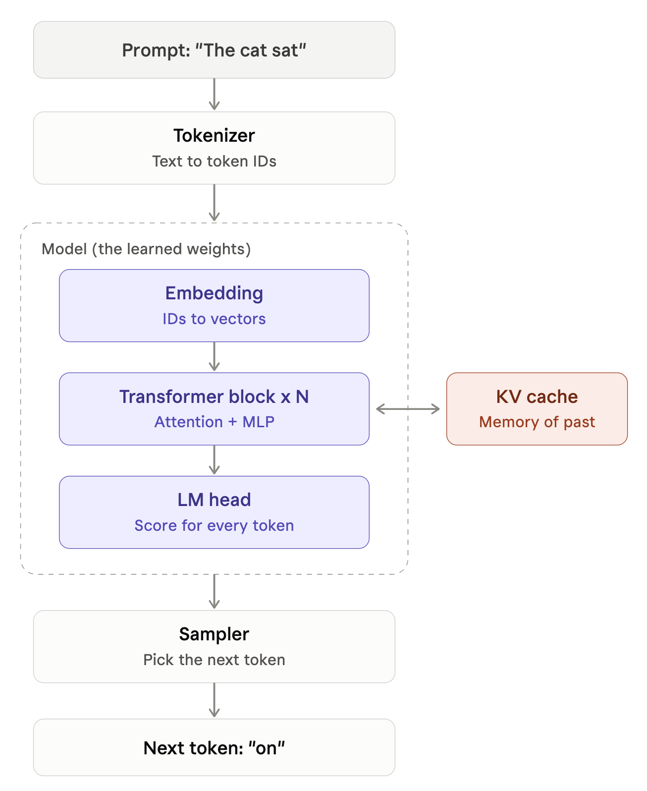

# LLM Architecture

A LLM model consists of two phases **Pre-fill** and **Decoding**:

* **Reading the Prompt (Pre-fill Phase):** When the model first receives the prompt "The cat sat", the tokens are **not** processed sequentially. The Transformer architecture allows it to process all the input tokens simultaneously in parallel. The model keeps track of the word order using positional mathematical markers added during the initial "Embedding" phase. This parallel processing makes reading the prompt extremely fast.

* **Generating New Text (Decoding Phase):** When the model starts creating new words, tokens **are** processed sequentially. The model must generate the "Next token: 'on'" first. Then, it feeds "on" back through the Transformer blocks to update the "KV cache", which it uses to predict the word that comes after "on". This one-by-one generation is strictly sequential.

## Transformer Blocks
The "Transformer block x N" stage is the core engine of the model, consisting of Attention and MLP layers. After the initial embedding step converts token IDs into a list of vectors, this list passes sequentially through a series of *N* identical blocks.

Here is what happens inside each of those *N* Transformer blocks to process the text:

* **Self-Attention:** This is where the model builds context. The vectors in the sequence interact with one another, allowing each word to "look" at surrounding words to understand relationships. For instance, in the prompt "The cat sat", the attention mechanism helps the vector for "sat" connect with "cat" to understand the subject of the action.

* **KV Cache Interaction:** As shown in the architecture diagram, the Transformer block communicates with a "KV cache". This cache acts as a "Memory of past" tokens. When generating text one token at a time, the model stores the Key (K) and Value (V) mathematical representations of previously processed words here. Instead of recalculating the context for the entire sentence every single time it predicts a new word, it simply pulls the past context from the KV cache, making generation highly efficient.

* **Multi-Layer Perceptron (MLP):** After the attention step updates the vectors with contextual information, they are passed through a standard feed-forward neural network, labeled as MLP. While the attention mechanism mixes information *between* different words, the MLP processes each word's vector *individually*. This step refines the vector's mathematical representation, extracting deeper facts, logic, and patterns learned during training.

* **Sequential Stacking (x N):** The output of the first Transformer block is a new, context-enriched list of vectors. This list becomes the direct input for the second block, which repeats the Attention and MLP steps. This happens *N* times (often 32, 64, or more layers depending on the model size). Early blocks typically identify basic grammar and syntax, while deeper blocks build complex semantic understanding and reasoning.

Once the list of vectors emerges from the final *N*th block, it is a highly evolved representation of the input text. It is then passed to the "LM head" to calculate a score for every possible next token.
