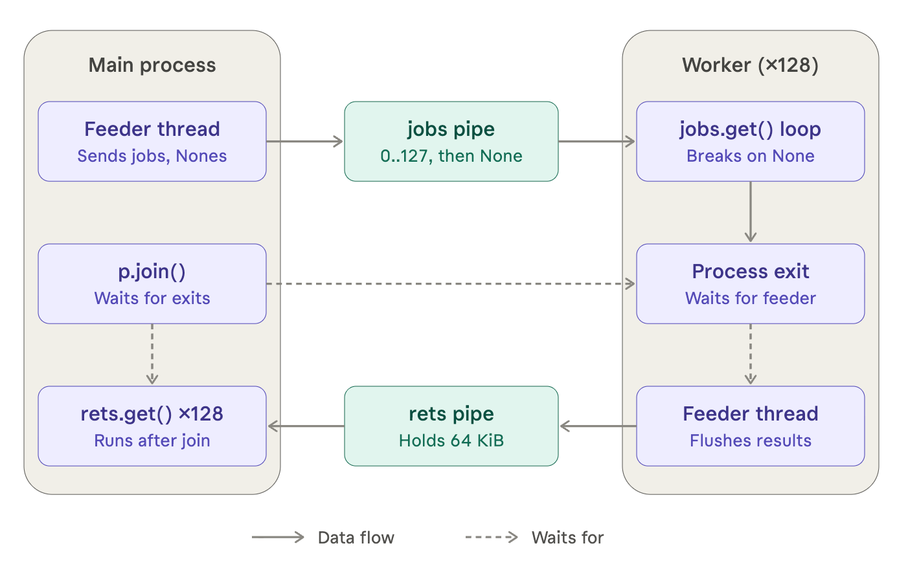

# Multiprocessing Queues
Below is a diagram of the processes and the two queues. Solid arrows show data moving. Dashed arrows show one step waiting for another to finish.

The problem is the chain of dashed arrows. Follow it from `p.join()`:

1. `p.join()` waits for a worker to exit.
2. The worker's exit waits for its feeder thread.
3. The feeder thread waits for space in the `rets` pipe.
4. Space only appears when the main process calls `rets.get()`, which comes after `p.join()`.

If the results fit in the pipe's 64 KiB, step 3 never has to wait, so the chain finishes. That's why your program works. If they don't fit, the chain loops back to the start and nothing can move. Reading `rets` before calling `p.join()` fixes this, because the main process is then emptying the pipe while workers exit.

## 1. How many feeder threads are there?

A feeder thread belongs to one queue in one process, and it's only created the first time that process calls `put()` on that queue. Calling `get()` never creates one. In your program:

| Process | `jobs` queue | `rets` queue | Feeder threads |
|---|---|---|---|
| Main | calls `put()` | calls `get()` only | 1, for `jobs` |
| Each worker | calls `get()` only | calls `put()` | 1, for `rets`, but only if it processed at least one job |

So the total is 1 plus the number of workers that processed at least one job, never more than 129.

I counted feeder threads in a run of your program:

- The main process had 0 before its first `jobs.put()` and 1 after it.
- 45 of the 128 workers processed jobs, and each had exactly 1 feeder thread.
- The other 83 workers got only their `None`, never called `rets.put()`, and had no feeder thread.

That run had 46 feeder threads in total, and the number changes from run to run. Workers that start early grab many jobs. Workers that start late often find only `None`s left.

My diagram simplified this by giving every worker a feeder. Only workers that processed a job have one. The others have nothing to flush, so they exit straight away and can never get stuck.

## 2. Why does the feeder thread appear in both the main process and the workers?

A feeder thread belongs to whichever process writes to a queue. Being the main process or a worker has nothing to do with it. In your program each process writes to a different queue:

- **Main writes to `jobs`**, so it gets the feeder for `jobs`.
- **Workers write to `rets`**, so each worker that writes gets its own feeder for `rets`.

Each process needs its own feeder because a thread lives inside one process and can't be shared with another. When you pass a `Queue` to a worker, the worker gets its own copy of the queue object. That copy starts with an empty buffer and no feeder thread. Only these parts are shared between processes:

- **Shared:** the operating-system pipe, plus the locks that stop two writers from mixing their data.
- **Private to each process:** the buffer that `put()` appends to, and the feeder thread that empties that buffer into the pipe.

So any `put()` in any process does the same thing: add the item to that process's own buffer, and let that process's own feeder thread write it to the shared pipe.

The thread exists so that `put()` returns immediately. Pickling the item, and writing to the pipe (which can block when the pipe is full), happen in the background. The downside is the rule from before: a process can't exit until its feeder thread has written out everything in its buffer.

That rule also applies to the main process and its `jobs` feeder, but there it's harmless. The workers are reading `jobs`, so that pipe keeps emptying.